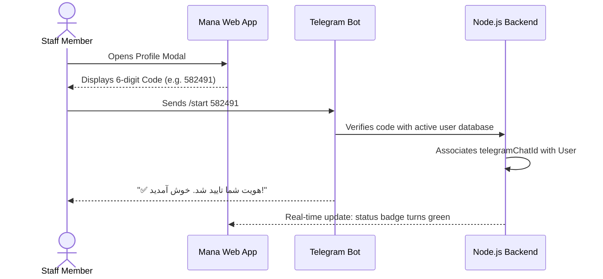
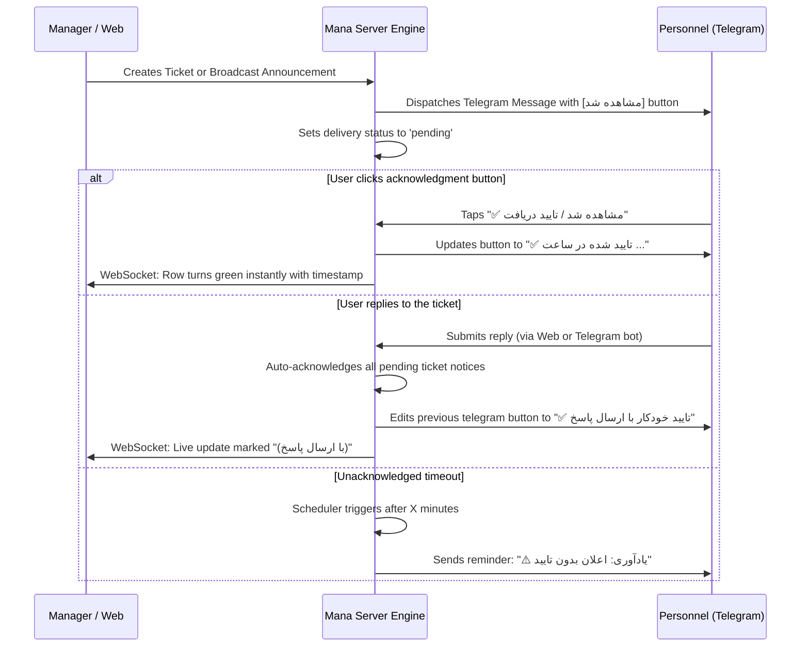

# 🎫 Mana Ticketing & Broadcast System
### Modern, Self-Hosted Enterprise Ticketing, Telegram Bot Automation & Delivery Handshake Platform

[](LICENSE)
[](https://nodejs.org/)
[](#progressive-web-app-pwa)
[-purple.svg)](#persian-rtl-localization)
[](#telegram-bot-integration)

**Mana Ticketing** is an open-source, self-hosted, full-stack ticketing, workflow automation, and organizational broadcast platform. Designed specifically for **Persian-speaking organizations, companies, and distributed teams**, it bridges internal team collaboration with **Telegram Bot API**, offering a unique **Delivery Handshake (Read Receipt) Protocol**, interactive multi-file Telegram ticket replies, background auto-reminders, and full proxy resilience tailored for deployment in restrictive networking environments (e.g., Iran local servers).

---

## 🌟 Highlights & Philosophy

- 🇮🇷 **Native Persian (Farsi) & RTL First**: Built from the ground up for Persian typography (**IRAN Rounded** & **Vazirmatn**), full Jalali (Shamsi) calendar support, Persian digits, and standard Right-to-Left (RTL) ergonomics.
- 🤖 **Deep Telegram Bot Integration**: Connects your organization's workflow directly into Telegram with 6-digit zero-friction pairing, interactive ticket replies, and multi-file draft sessions.
- 🤝 **Delivery Handshake Protocol**: Guarantees that employees have read critical notices or tickets through a mandatory *"مشاهده شد / تایید دریافت"* (Acknowledged) handshake button, with real-time audit logs and automatic background re-send schedulers.
- ⚡ **Real-Time Sync with Network Resilience**: Sub-50ms WebSocket updates paired with an intelligent **8-second HTTP fallback polling engine**, keeping mobile and desktop clients connected even when VPNs or proxies disrupt WebSockets.
- 🛡️ **Self-Hosted & Privacy-Conscious**: 100% on-premise storage of attachments, tickets, and user data. Zero external SaaS dependencies.

---

## 🚀 Key Features

### 1. 🎫 Enterprise Ticket Management
- **Full Workflow Pipeline**: Track tickets across `Open`, `In Progress`, `Waiting`, and `Resolved / Closed` states.
- **Multi-Person Tagging & Assignments**: Assign a lead assignee and tag multiple team members concurrently.
- **SLA Deadlines & Visual Timers**: Set precise deadlines with color-coded status pills (green, warning orange, pulsing urgent red for SLA breaches).
- **Rich Attachments**: Upload and preview documents, images, PDFs, logs, spreadsheets, and archives up to 25 MB per file.
- **Department Categorization**: Filter by Technical, Software Development, Support, Marketing, Finance, HR, and Operations.

### 2. 🤖 Telegram Bot Integration & Delivery Handshakes
- **Instant Account Pairing**: Users link their Telegram accounts by typing `/start <code>` using a 6-digit code from their user profile modal.
- **Immediate Notification Dispatch**: When a ticket is created, updated, or replied to, all relevant participants receive real-time alerts on Telegram.
- **Proof of Receipt (Handshake)**:
  - Each message includes an inline acknowledgment button.
  - Tapping records the user's name and exact Jalali timestamp in the server database.
  - The message button updates instantly to `✅ تایید شده در ...`.
  - The admin monitoring panel reflects confirmations in real time.
- **Interactive Multi-Item Ticket Replies via Telegram**:
  - Tapping *"💬 پاسخ به این تیکت در تلگرام"* starts an interactive draft session.
  - Users can send multiple texts, high-resolution photos, voice notes, and documents in sequence.
  - Live draft status message updates dynamically with item counts and text preview.
  - A final confirmation button (`📤 تایید و ارسال نهایی پاسخ`) commits the reply to the central database, immediately visible to all web users.
- **Implicit Handshake on Reply**: Submitting a ticket reply (either via web or Telegram) automatically validates and marks all unconfirmed notifications for that ticket as acknowledged.
- **Automated Reminder Scheduler**: If a notification remains unconfirmed, a background cron scheduler periodically re-alerts the user up to $N$ times at configurable minute intervals.
- **Iran Server & Proxy Support**: Built-in SOCKS5h / HTTP proxy tunnel with remote DNS resolution to bypass local Iranian DNS poisoning of Telegram endpoints.

### 3. 📢 Organizational Broadcasts & Circulars
- Send official organizational announcements (*بخشنامه‌ها و اعلانات*) targeted to specific departments or all company staff.
- Set priority tiers (`عادی`, `فوری`, `محرمانه`).
- Live audit board showing which staff members have confirmed receipt and who is pending.

### 4. 🛡️ Superadmin Control Center (`/superadmin.html`)
- Dedicated administrative portal protected with secure hashing.
- Real-time hardware and platform metrics (ticket counts, active users, handshake stats, system uptime).
- **Telegram Live Proxy Tester**: Test Telegram Bot Token and SOCKS5h/HTTP proxy connectivity directly from the UI with descriptive error reporting.
- **Deliveries & Handshake Audit Board**: Inspect every outgoing dispatch, recipient status, resend counters, and manual trigger buttons.
- Comprehensive security audit log viewer.
- Safe factory reset utilities.

### 5. 👥 Role-Based Access Control (RBAC) & Teams
- Built-in roles: `Admin` (مدیر سیستم), `Manager` (سرپرست), `Staff` (کارشناس فنی), `Member` (پرسنل عادی).
- Granular permission matrix:
  - `view_all_tickets`
  - `create_ticket`
  - `edit_all_tickets`
  - `delete_ticket`
  - `reassign_ticket`
  - `manage_roles`
  - `manage_users`
  - `view_reports`
- User management: Add, edit, restrict/suspend users, and unlink Telegram accounts.

### 6. 📱 Progressive Web App (PWA) & Persian UX
- Installable on **Android, iOS, Windows, macOS, and Linux** with custom icons and splash screens.
- **True Dark Mode**: Sleek slate-950 dark theme with high-contrast accessibility.
- **Web Audio Chime**: Musical notification bell synthesised via Web Audio API.
- **Service Worker Web-Push**: Native push notifications even when the browser tab is closed.

---

## 🏗️ Architecture & Technology Stack

```
mana-ticketing/
├── index.html                   # Main Single Page App (Persian RTL, Tailwind CDN)
├── superadmin.html              # Superadmin Server Control Panel
├── manifest.json                # PWA Manifest configuration
├── sw.js                        # Service Worker for offline caching & Push
├── css/
│   └── styles.css               # Typography (IRAN Rounded, Vazirmatn) & Dark Mode rules
├── js/
│   ├── app.js                   # Application lifecycle & view router
│   ├── state.js                 # Central reactive event bus & state store
│   ├── notifications.js         # Sound chime & Web Notifications engine
│   ├── superadmin.js            # Superadmin dashboard controller
│   ├── storage/
│   │   ├── local.js             # Offline localStorage provider
│   │   └── server.js            # WebSocket sync & smart HTTP polling fallback
│   ├── components/
│   │   ├── navbar.js            # Top bar, notifications dropdown, dark mode toggle
│   │   ├── ticketList.js        # Responsive ticket feed, filtering, SLA indicators
│   │   ├── ticketModal.js       # New ticket creation modal with drag-and-drop
│   │   ├── ticketDetail.js      # Conversation timeline, reply box, file preview
│   │   ├── adminTab.js          # Organization management, deliveries audit, announcements
│   │   ├── profileModal.js      # User profile, Telegram pairing code display
│   │   └── loginModal.js        # Authentication modal
│   └── utils/
│       ├── jalali.js            # Persian Shamsi calendar converter & relative time
│       └── audio.js             # Synthesized chime sound generator
├── server.js                    # Express HTTP server & WebSocket gateway
├── server/
│   ├── db.js                    # File-based JSON database engine with atomic writes
│   ├── auth.js                  # JWT issuance, verification & authentication middleware
│   ├── telegram.js              # Telegram Bot API client, SOCKS5h agent, long-polling
│   ├── scheduler.js             # Background timer for unacknowledged reminders
│   ├── push.js                  # Web-Push notification dispatcher
│   └── routes/
│       ├── api.js               # Core REST API (tickets, replies, deliveries, users)
│       └── superadmin.js        # Superadmin management endpoints & proxy tester
├── data/                        # JSON database storage
└── uploads/                     # Server-side attachment & avatar storage
```

---

## 📥 Installation & Quick Start

### Prerequisites
- **Node.js**: Version `18.x` or higher
- **NPM**: Version `9.x` or higher
- **Linux Server** (Ubuntu 20.04/22.04/24.04 recommended) or local workstation

### 1. Clone & Install Dependencies
```bash
git clone https://github.com/MatinRafiei/mana-ticketing.git
cd mana-ticketing
npm install
```

### 2. Run in Development Mode
```bash
npm start
```
By default, the server listens on `http://localhost:3000`.

- Open `http://localhost:3000` to access the ticketing platform.
- Open `http://localhost:3000/superadmin.html` to access the Superadmin Panel.

---

## 🚀 Production Deployment (Linux + systemd + Nginx)

### 1. Systemd Service Setup
Create a service file to ensure 24/7 uptime and auto-restart on boot:

```bash
sudo nano /etc/systemd/system/mana-ticketing.service
```

Paste the following configuration (adjust path and user):
```ini
[Unit]
Description=Mana Ticketing & Telegram Broadcast Platform
After=network.target

[Service]
Type=simple
User=root
WorkingDirectory=/var/www/ticketing
ExecStart=/usr/bin/node /var/www/ticketing/server.js
Restart=always
RestartSec=5
Environment=NODE_ENV=production
Environment=PORT=3000

[Install]
WantedBy=multi-user.target
```

Enable and start the service:
```bash
sudo systemctl daemon-reload
sudo systemctl enable mana-ticketing
sudo systemctl start mana-ticketing
sudo systemctl status mana-ticketing
```

### 2. Nginx Reverse Proxy & WebSocket Configuration
Configure Nginx with WebSocket upgrade support and 50MB client payload limits:

```nginx
server {
    listen 80;
    server_name ticketing.yourdomain.ir;

    client_max_body_size 50M;

    location / {
        proxy_pass http://127.0.0.1:3000;
        proxy_http_version 1.1;

        # WebSocket support headers
        proxy_set_header Upgrade $http_upgrade;
        proxy_set_header Connection "upgrade";

        proxy_set_header Host $host;
        proxy_set_header X-Real-IP $remote_addr;
        proxy_set_header X-Forwarded-For $proxy_add_x_forwarded_for;
        proxy_set_header X-Forwarded-Proto $scheme;

        # Timeouts for persistent polling & WebSockets
        proxy_read_timeout 300s;
        proxy_send_timeout 300s;
    }
}
```

Reload Nginx:
```bash
sudo nginx -t && sudo systemctl reload nginx
```

---

## 🤖 Telegram Bot & Iran Server Proxy Setup

If your server is located in Iran or behind restrictive firewalls where `api.telegram.org` is filtered or DNS poisoned:

1. **Obtain Bot Token**: Create a bot via [@BotFather](https://t.me/BotFather) and copy the HTTP API token.
2. **Setup Proxy Outbound**:
   - Run a local SOCKS5 or HTTP inbound (e.g., using **V2Ray**, **Xray**, or **Sing-Box**).
   - Example local SOCKS5 inbound: `127.0.0.1:1080`
3. **Configure in Superadmin**:
   - Go to `http://your-server:3000/superadmin.html`
   - Log in and navigate to **تنظیمات ربات تلگرام** (Telegram Bot Settings).
   - Enter your Bot Token.
   - Enter the Proxy URL using `socks5h://` to ensure **remote DNS resolution**:
     ```
     socks5h://127.0.0.1:1080
     ```
   - Click **تست اتصال به تلگرام**. You should receive a green success notification:
     > `✅ اتصال با موفقیت برقرار شد. ربات: @YourBotName`
   - Save settings. The bot worker starts polling immediately!

---

## 🔑 Default Credentials

> ⚠️ **IMPORTANT**: Change default credentials immediately after first login!

| Portal | URL | Default User | Default Password | Role |
| :--- | :--- | :--- | :--- | :--- |
| **Ticketing Panel** | `http://localhost:3000` | `manager@company.com` | `123456` | مدیر سامانه (Admin) |
| **Superadmin Panel** | `http://localhost:3000/superadmin.html` | `superadmin` | `admin1234` | سرپرست ارشد سرور |

---

## 👥 How Telegram Account Pairing Works



---

## 📜 Delivery Handshake Workflow



---

## 🤝 Contributing

Contributions, issues, and feature requests are welcome!
Feel free to check [issues page](https://github.com/MatinRafiei/mana-ticketing/issues).

1. Fork the Project (`git checkout -b feature/AmazingFeature`)
2. Commit your Changes (`git commit -m 'feat: Add some AmazingFeature'`)
3. Push to the Branch (`git push origin feature/AmazingFeature`)
4. Open a Pull Request

---

## 📄 License

Distributed under the **MIT License**. See `LICENSE` for more information.

---

<div align="center">
  <sub>Developed with ❤️ for Iranian tech teams, startups, and enterprises.</sub>
</div>
